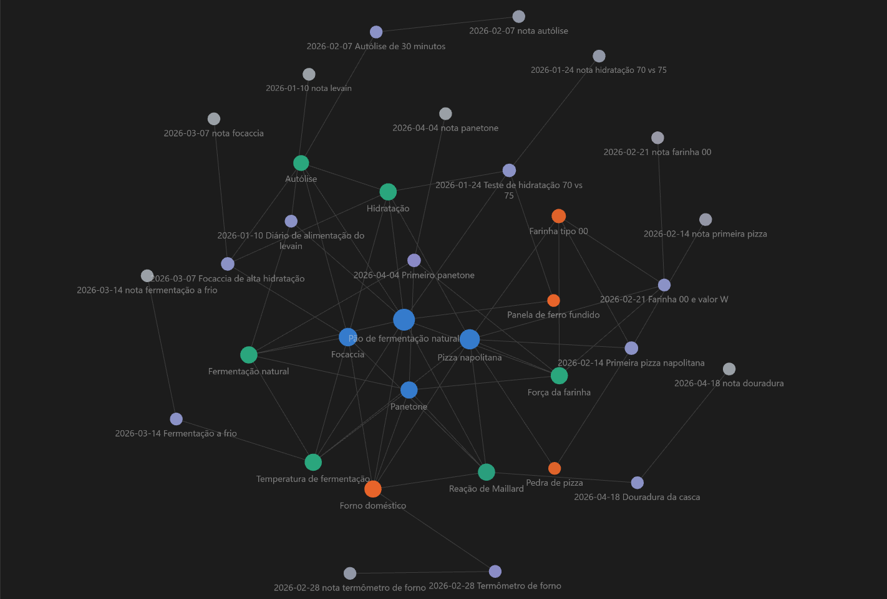
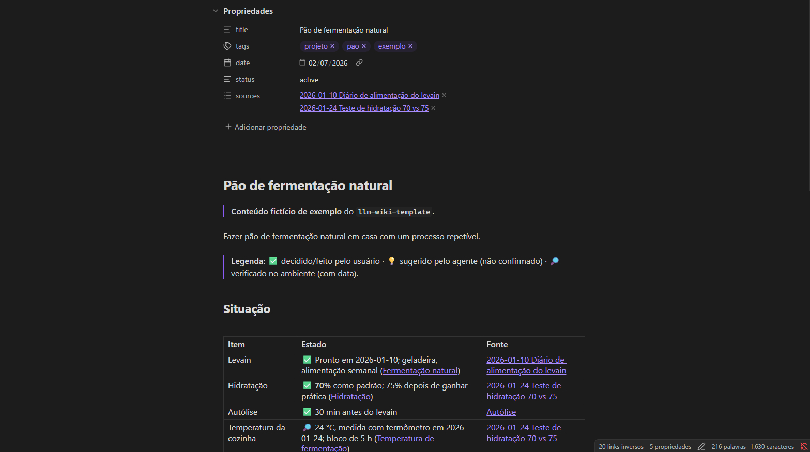

# llm-wiki-template

**Português** | [English](README.en.md)

[](https://github.com/pietrogconte/llm-wiki-template/blob/main/LICENSE)
[](https://www.python.org/)
[](https://github.com/pietrogconte/llm-wiki-template/actions/workflows/lint.yml)

Template pronto para instanciar uma **LLM Wiki**: uma base de conhecimento persistente e interligada em markdown, **mantida por um agente de LLM** (Claude Code, Codex, etc.) em vez de um RAG que rederiva tudo a cada pergunta. Vem com um schema genérico (`CLAUDE.md`/`AGENTS.md`), a estrutura de pastas, um lint da wiki (hook opcional + CI), um preset opcional do Obsidian e uma wiki de exemplo completa numa branch separada.

## Capturas de tela

<p align="center">
  
  
</p>

<p align="center"><sub>Wiki fictícia da branch <a href="https://github.com/pietrogconte/llm-wiki-template/tree/example"><code>example</code></a>, aberta no Obsidian com o preset deste repo.</sub></p>

## O que é

A maioria dos fluxos de RAG (NotebookLM, upload de arquivos no ChatGPT, etc.) recupera trechos na hora da pergunta e não acumula nada: toda pergunta que exige cruzar várias fontes força o LLM a reconstruir a síntese do zero.

Aqui o agente **constrói e mantém uma wiki**. A cada fonte nova ele lê, extrai o que importa e integra na wiki existente: atualiza páginas de projeto, conceito e entidade, revisa sínteses e aponta contradições com o que já estava escrito. O conhecimento é compilado uma vez e **mantido atualizado**.

A ideia é de Andrej Karpathy ([gist `llm-wiki.md`](https://gist.github.com/karpathy/442a6bf555914893e9891c11519de94f)); este repo é uma implementação pronta para usar. Detalhes de camadas, operações e decisões de projeto em [ARCHITECTURE.md](ARCHITECTURE.md).

## Quickstart

1. **Crie seu repo** a partir deste (botão "Use this template" no GitHub) e clone.
2. **Edite o `CLAUDE.md`**: troque o placeholder `<domain>` pelo que a wiki vai rastrear e apague o que não servir. Mantenha o `AGENTS.md` igual (para Codex e outros harnesses).
3. **Solte a primeira fonte** em `raw/` (artigo, transcrição, PDF, nota).
4. **Peça ao agente um Ingest** (ex.: "faça o Ingest de `raw/minha-fonte.md`"). Ele cria a página da fonte, atualiza as páginas afetadas, o `wiki/index.md` e o `wiki/log.md`.
5. **Leia e pergunte**: navegue pela wiki (no Obsidian, se quiser) e peça **Queries** ao agente. Rode `python scripts/lint_wiki.py` de vez em quando, ou ative o hook (veja [Lint](#lint)).

### Estrutura

```
.
├── CLAUDE.md / AGENTS.md   # schema: como o agente mantém a wiki
├── raw/                    # fontes originais, imutáveis (anexos em raw/assets/)
├── wiki/
│   ├── index.md            # catálogo de todas as páginas
│   ├── log.md              # log cronológico, append-only
│   ├── projects/  concepts/  entities/  sources/
├── scripts/lint_wiki.py    # lint da wiki (só stdlib)
├── .githooks/pre-commit    # hook opcional que roda o lint
├── obsidian-preset/        # configuração opcional do Obsidian
└── docs/img/               # imagens do README
```

## Usando com o Obsidian

O Obsidian é um bom leitor para a wiki: o agente escreve, você lê e navega.

- **Instalação (Windows):** `winget install --id Obsidian.Obsidian -e --source winget`. O instalador é assinado digitalmente (Dynalist Inc), então não esbarra no Smart App Control.
- **Abra a raiz do repo como cofre** (*Open folder as vault*), não só `wiki/`: as páginas apontam para `raw/` e o `CLAUDE.md` fica à mão. A pasta `.obsidian/` está no `.gitignore`.
- **Navegação:** comece pelo `wiki/index.md`; o `wiki/log.md` é o histórico. Use Quick Switcher (`Ctrl+O`), busca (`Ctrl+Shift+F`), backlinks, Graph View (`Ctrl+G`) e o grafo local (`Ctrl+P` → "Open local graph"). Atenção: clicar num link para uma página inexistente cria um arquivo vazio (o lint acusa).
- **Fluxo:** quem escreve é o agente (Ingest, Query, Lint). Se editar à mão, commite pelo terminal e avise o agente na próxima sessão. Nunca edite `raw/`.
- **Plugins da comunidade** (inclusive o *Obsidian Git*) são código de terceiros com acesso ao cofre inteiro: mantenha o **modo restrito** ligado e só instale algo depois de revisar. Para o git, o terminal basta.

### Preset opcional

A pasta `obsidian-preset/` traz um ponto de partida. É **opcional**: não precisa dele para usar a wiki.

- `app.json`: links no formato `[[wikilinks]]`, anexos em `raw/assets`, atualizar links automaticamente ao renomear e título embutido desligado (as páginas já têm H1 próprio; ele duplicaria o título).
- `graph.json`: o grafo esconde `index`, `log`, `CLAUDE`, `AGENTS` e os documentos do repo, e colore os nós por pasta (projects, concepts, entities, sources e as notas de `raw/`).

Copie para `.obsidian/` **antes de abrir o cofre** (ou com o Obsidian fechado, porque sobrescreve as configurações existentes):

```powershell
# Windows (PowerShell), na raiz do repo
New-Item -ItemType Directory -Force .obsidian | Out-Null; Copy-Item obsidian-preset\*.json .obsidian\
```
```bash
# Linux/macOS, na raiz do repo
mkdir -p .obsidian && cp obsidian-preset/*.json .obsidian/
```

Depois, ajuste como quiser pelas configurações do Obsidian; o preset não amarra nada.

## Lint

`scripts/lint_wiki.py` faz as checagens **mecânicas** da wiki. Só usa a biblioteca padrão (Python 3.9+), só lê arquivos e sai com código diferente de zero quando há erro:

```bash
python scripts/lint_wiki.py            # avisos não falham
python scripts/lint_wiki.py --strict   # avisos também falham
python scripts/lint_wiki.py --root ../outra-wiki
```

| Código | Checagem |
|---|---|
| E1 | `[[link]]` quebrado |
| E2 | `.md` vazio |
| E3 | página da wiki fora do `wiki/index.md` |
| E4 | frontmatter ausente ou incompleto (`title`, `tags`, `date`, `status`, `sources`) |
| E5 | link markdown relativo para arquivo sem extensão (o Obsidian criaria um `.md` vazio) ou para `.md` inexistente |
| E6 | exemplo `[[link]]` fora de crases em documentos (README, CLAUDE, etc.) |
| E7 | item repetido numa lista do frontmatter (`tags`, `sources`, etc.), em linha ou em bloco |
| W1 | aviso: arquivo em `raw/` sem menção no `log.md` nem em `wiki/sources/` (ingest pendente?) |

As checagens **semânticas** (contradições, afirmações desatualizadas, referências cruzadas faltando) continuam sendo a operação **Lint** do agente, descrita no `CLAUDE.md`.

<details>
<summary><strong>Hook pre-commit opcional e CI (clique para expandir)</strong></summary>

**Hook.** Ative uma vez por clone; desative quando quiser:

```bash
git config core.hooksPath .githooks          # ativa
git config --unset core.hooksPath            # desativa
```

O hook é um script `sh` que o próprio Git executa: nada de `.bat` ou `.ps1`, que o Smart App Control do Windows bloqueia. Ele tenta `py -3`, `python3` e `python`, nessa ordem, e só usa um interpretador que de fato roda (o atalho da Microsoft Store, que abre a loja, é descartado). Se não achar nenhum, avisa e **deixa o commit passar**.

**CI.** O workflow `.github/workflows/lint.yml` roda o lint em todo push e pull request, com Python 3.9 e 3.12.

</details>

## Wiki de exemplo

A `main` vem vazia, pronta para a sua wiki. Para ver uma wiki completa seguindo o schema, com 4 projetos, 6 conceitos que funcionam como hubs, 4 entidades, 10 fontes, index, log e a legenda de proveniência, use as branches de exemplo. O conteúdo é fictício e passa no lint:

| Branch | Idioma |
|---|---|
| [`example`](https://github.com/pietrogconte/llm-wiki-template/tree/example) | português |
| [`example-en`](https://github.com/pietrogconte/llm-wiki-template/tree/example-en) | inglês |

```bash
git clone -b example https://github.com/pietrogconte/llm-wiki-template.git llm-wiki-example
```

## Opcional: memória entre sessões

A wiki funciona sozinha. Se quiser que o agente não perca contexto entre sessões longas ou reinícios, dá para combinar com o [MemPalace](https://github.com/MemPalace/mempalace), que é configurado uma vez por máquina, não por wiki: veja [pietrogconte/mempalace-setup](https://github.com/pietrogconte/mempalace-setup). A wiki continua sendo a síntese curada; o MemPalace é só recall do histórico de conversas.

## Contribuindo

Sugestões, correções e pull requests são bem-vindos. Abra uma issue descrevendo o problema ou a melhoria antes de mudanças maiores, e rode `python scripts/lint_wiki.py` antes de enviar. Histórico de versões em [CHANGELOG.md](CHANGELOG.md).

## Créditos

- Padrão da LLM Wiki: Andrej Karpathy.
- Template montado com [Claude Code](https://claude.com/claude-code).

## Licença

MIT. Veja o arquivo `LICENSE` na raiz do repositório.
